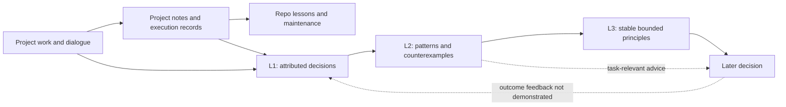

# Memory review — October 23, 2026

**The system is better aligned with the original goal, but the two outcomes have progressed at different rates.** Project records generally support useful recovery. Personal judgments are now captured and attributed, and L2 performs real interpretation. Source continuity, broader synthesis, and evidence that memory improves later decisions remain weak.

This review used three independent subagents for project records, judgment extraction, and scheduling/coverage. It inspected the installed skill, current state, completed runs, selected original sources, four requested local projects, and one bounded SCG read. It compared the current implementation with the September audit and Yage's reference. It did not change production skills, schedules, project notes, personal memory, or Git branches. Only these audit artifacts were created.

**Current state, in plain language**

| Part | What it actually does | Assessment on October 23 |
| --- | --- | --- |
| Project records | Notes preserve questions, findings, choices, variants, and limitations; manifests describe execution; lessons carry reusable checks. | Useful and largely recoverable in the sample. This does not establish complete reproducibility or scientific validity. |
| L1 Observer | Reviews a bounded sample of registered notes and completed dialogue turns; records attributable choices. | 343 event interpretations: 115 direct-user and 228 note-attributed. These are not 343 independent decisions. Coverage is incomplete. |
| L2 Reflector | Compares episodes, separates context, searches counterexamples, and revises principles. | Five reflections and two candidates. October reviews made substantive changes, but some research-priority patterns remain ungrouped. |
| L3 Axiom | Reviews stable patterns for promotion, with recoverable evidence, boundaries, and predicted choices. | One active axiom, created in the September repair; no new axiom since then. Its original evidence is now flagged unavailable. |
| Use and feedback | Relevant principles can be consulted during a later task. | Routing instructions exist. The inspected records do not demonstrate improved later choices or fewer repeated corrections. |

The authoritative ledger is [decision_memory_v1.json](/Volumes/IF_PHAGE/long-term-memory/state/decision_memory_v1.json). The [audit snapshot](evidence-summary.json) records its hash and derived counts. Counts describe this snapshot, not a complete census of the user's history.

**Your impression of project-record integrity is supported, within the audit's bounds.**

The local audit sampled current indexes, lessons, and branch notes across the requested projects, checked 343 literal local Markdown links in six sampled files, and verified two selected manifests. All checked links resolved. Both manifests passed schema and declared-file checks, with important limits: some files were checked only for existence, and large input hashes were skipped. This proves a narrower result than reconstruction of every run.

The notes and lessons contain substantive scientific corrections. In topic_analysis, the current notes preserve the original sex-report approval, explicitly withdraw the p-derived uncertainty/difference inference, and identify the replacement HC3 interaction as exploratory with a different estimand. The lessons turn this into a future check: do not reconstruct effect uncertainty from those p-values. This is useful maintenance because it changes what a future reader should trust. See the [analysis note](/Volumes/IF_PHAGE/topic_analysis/results/artery-vein-fate/crt_program_ucell_no_celltype/NOTES.md:2276) and [lesson](/Volumes/IF_PHAGE/topic_analysis/docs/LESSONS.md:128).

Practice lessons also preserve specific investigator judgments: retain faint branches; separate vessel identity from geometric appearance; assess missed vessels rather than only surviving detections. These are functional instructions, not a diary. Their presence does not prove later agents consistently followed them. See [practice lessons](/Volumes/IF_PHAGE/practice/docs/LESSONS.md:14).

Findability remains uneven. The core CRT note has 2,677 lines, and the Penn note has 1,934. Current answers are often placed well, but historical detail still imposes a reading cost. Length alone does not justify deletion: some details own the only surviving explanation of an earlier choice.

Only topic_analysis and cross-species-analysis have scheduled documentation workers. Practice, claude_code_task, and SCG are personal-memory sources, but their notes depend on normal project work. The maintenance queue currently has 31 resolved, 46 rejected, four deferred, and two open items, with no claims left hanging. Forty rejected items were explicitly waived historical work; they were not repaired provenance.

The audit also found a health-check blind spot: the bootstrap helper scans results/ for manifests and reports zero for practice, while 35 manifests exist under output/fzd4_arterialization/runs/. A green or empty structural summary needs interpretation. Details and exact checks are in [project-integrity findings](project-integrity.md).

**L1 is substantially better, but its evidence base suffered a major break.**

The redesign now accepts first occurrences, keeps direct and note-attributed decisions separate, and records alternatives, reasons, costs, uncertainty, and future tests. It does not use routine automation compliance as personal confirmation. Those changes address the original failure directly.

However, matching local sessions fell from **722 on October 14 to 87 on October 15**. That is 635 fewer discoverable sessions, an 88% drop. The run selected only 24 sources; this was not successful backlog processing. The four source contexts for the active axiom became unavailable at the same boundary. The cause of the disappearance from configured roots is not established, and this review does not infer deletion or permanent loss.

The private archive was created on October 20, after this break. Its records describe read-only copying, and the four axiom session IDs were not found in its current inventory. Thus the new archive is not evidence that it moved or deleted those sessions. It provides a future preservation route, but does not repair these missing contexts. Retained quotations remain available.

The latest run reports 99 discovered sources not selected and 126 local sessions not scanned. These are different, bounded counters. They exclude sources that are no longer discoverable and do not quantify all missing judgments. A lower counter cannot be treated as progress without a stable inventory denominator.

Coverage now includes local Codex and Claude Code, nine local repository roots, and SCG. Claude began contributing to daily runs on October 22. Hepatocyte and imaging_analysis are absent from the registry; their own working-directory histories are therefore excluded. OpenCode and ChatGPT histories also remain unconfigured. The human registry table omits two sources that the machine registry already includes.

SCG was available in four of 19 applied October collection runs, including a manual/test run in that denominator. Our bounded read succeeded now through the existing connection helper. The schedule's repeated authentication, DNS, and socket failures remain unresolved; current access does not prove unattended reliability. See [schedule and coverage findings](schedule-coverage.md).

**L2 is working, but it is stronger at refining methods than discovering your wider research priorities.**

October 11 promoted two candidates to reflections. October 18 clarified two existing reflections and added a diagnostic candidate. The reviews distinguish independent episodes from several interpretations of one design discussion. They retain uncomfortable counterevidence, including the tension between preserving biological signal and selecting methods because they recover desired hits. That restraint is valuable.

Existing principles include preserving scientific ownership while improving expression, choosing evidence according to the measurement endpoint, and matching analytical variables to the biological question. These are useful bounded interpretations. They should not all become axioms merely because they sound sensible.

A promising omission is visible in the research-planning notes: biological questions and experimental validation repeatedly lead the narrative, while tools, resources, and prediction serve those aims. A possible candidate is:

> Build computational tools and models around a testable biological explanation and the next experiment; judge their contribution by the biology they enable.

This is an audit hypothesis, not a new personal-memory entry or endorsed rule. ERC and Penn records support examining it, but several dates belong to the same planning trajectory and retained evidence is note-attributed. The boundary matters: those same records preserve models and resources as substantive products. The interpretation must not become a claim that tools or prediction are unimportant. See [judgment-layer findings](judgment-layers.md).

This is closer to the original goal of preserving a distinctive research viewpoint than collecting another narrow diagnostic instruction. L2 should continue its careful checks while also making this broader synthesis explicit.

**There is one real axiom; the absence of new ones has several causes.**

The active axiom says: when identifying arterioles and collaterals, preserve faint connections even if more background remains, while still checking false connections. It specifies a biological endpoint, a priority, an accepted cost, and an exception. That qualifies as a meaningful judgment rather than generic advice. Its original support comprised three June–September episodes spanning 85 days. Its current [source-health warning](/Volumes/IF_PHAGE/long-term-memory/axioms/AXIOMS.md:20) correctly says the full context is no longer verified.

The automatic promotion rule requires three independent direct-user episodes over at least 28 days, recoverable sources, resolved counterevidence, and a task-use description. Most reflections currently cite only two direct episodes; more note-attributed records cannot substitute for a third. One software reflection spans many months and still has only two direct episodes. Time alone is not the missing ingredient.

L3 is also intentionally monthly. October eligibility was reviewed on October 3. The October 11 and 18 runs deferred another eligibility review to November while continuing L2. This adds latency, but it does not explain all non-promotion: evidence and independence gaps remain.

The implementation uses distinct session IDs as its mechanical episode count. This is a conservative proxy: separate decisions within one long-running chat cannot independently satisfy the numerical gate. Conversely, several chats can contain copies of one decision. Semantic review remains necessary. This implementation limit is worth correcting, but this audit has not established it as the principal cause of the present low axiom count.

I would retain strong evidence standards. Useful, explicitly provisional reflections can already inform a task without being promoted into permanent personal rules.

**The least developed part is the return from memory to actual work.**

Repo instructions point agents to task-relevant axioms. The ledger contains predicted choices and future tests, but no inspected structured record of retrieval, outcome, or whether a prediction helped. The routing view prominently exposes only the one axiom. We therefore cannot yet claim the system reduces repeated corrections or better anticipates your judgment.

There is also a concrete freshness gap. October 23 L1 added the historically true approval of the original sex-report plan. The same run's document review recognized its later withdrawal. The superseding personal event remains pending. Project notes and lessons are ahead of the personal ledger. If used without current project context, a truthful old memory can still give outdated guidance.

Yage's article describes a full cycle: collect behavior, distill stable judgments, load relevant context, and produce work that supplies new evidence. Its reference implementation asks for repeated validation and clear scope, but its axiom count is not a suitable target for this system. Our implementation has stronger explicit provenance checks; it has not demonstrated the final use-and-feedback step. See [Yage's article](https://yage.ai/context-infrastructure.html) and [reflector implementation](https://github.com/grapeot/context-infrastructure/blob/main/periodic_jobs/ai_heartbeat/src/v0/reflector.py).

**Recommended next changes, in order. These are review proposals, not applied repairs.**

1. **Protect source continuity and expose losses.** Keep a persistent inventory of expected evidence and distinguish consumed, deferred, moved, inaccessible, and missing sources. Integrate future archive lookup without pretending an exported summary equals a verified native source. Preserve enough authorized context to assess retained quotes.
2. **Prioritize known corrections.** When any loop discovers a reversal, put it into a high-priority reconciliation list. Link the old and new choices before presenting the earlier choice as current guidance. The sex-report case is a concrete acceptance test.
3. **Make weekly L2 a readable judgment review.** Show at most three proposed or revised patterns, one counterexample, exact evidence strength, and the next decision each would change. Include research priorities and scientific taste, not only implementation preferences. Keep full receipts behind links.
4. **Test useful memory in ordinary work.** In the next relevant task, record which principle informed a choice, the proposed action, the user's correction or acceptance, and the result. Do not count agent compliance or silence as independent confirmation. For microscopy, test whether weak target branches are explicitly checked before choosing cleanup settings.
5. **Repair operational alignment.** Investigate SCG's scheduled execution context; correct stale skill paths and registry prose; fix manifest discovery for output/ layouts; explicitly review source registration for newer projects. Keep current daily/weekly cadence while addressing these gaps.

The next review should ask whether source loss is visible, corrections reach the ledger, broader patterns are considered, and a relevant principle improved a real choice. More accumulated events or more axioms alone would not establish success.

**Evidence and limits**

- [Project-integrity review](project-integrity.md): sampled notes, lessons, links, manifests, and cross-layer correction.
- [Judgment-layer review](judgment-layers.md): principle quality, source checks, archive check, and candidate hypotheses.
- [Schedule/coverage review](schedule-coverage.md): configured and observed cadence, source inventory, deployment, and maintenance queue.
- [Structured audit snapshot](evidence-summary.json): ledger hash, counts, retained principle statements, and run metrics.
- [September baseline audit](/Volumes/IF_PHAGE/long-term-memory/audits/2026-09-17-personal-judgment/REPORT.md): historical state only; its old schedule and queue counts are not current.

No raw scientific data were reanalysed. No exhaustive dialogue review or scientific validation was performed. Source counts and link checks are bounded. The existing 43-reference historical gap was not reopened without a new lead.
